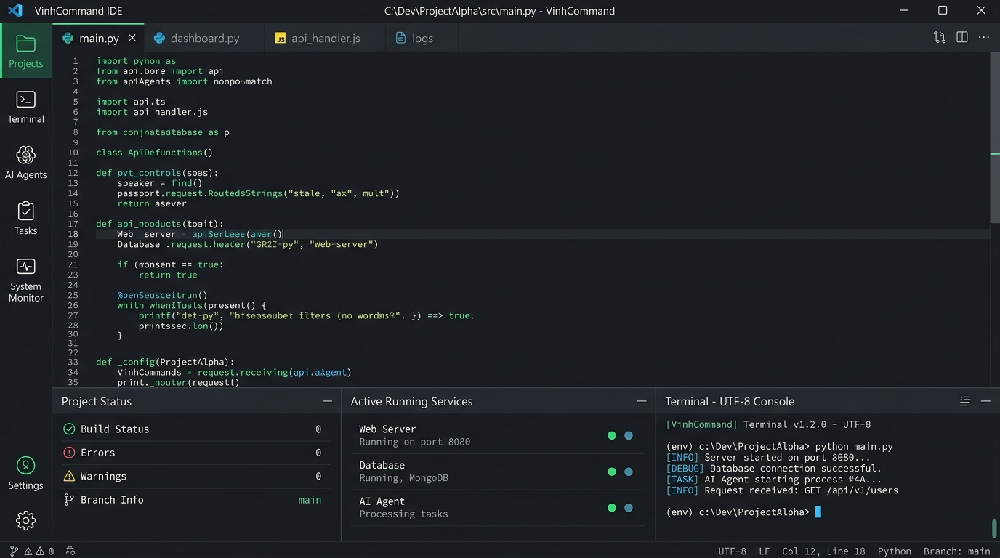
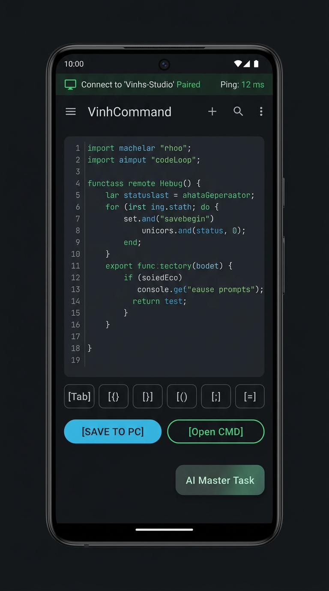

# VinhCommand

A unified cross-platform development environment and mobile companion system. VinhCommand connects a high-performance Windows desktop IDE with a native Android companion app, enabling remote file editing, local AI engine orchestration, and live multi-process runtime control over local area networks (LAN).

---

## Visual Interface & Demo Showcase

| Desktop IDE Workspace (Windows) | Mobile Companion (Android) |
| :---: | :---: |
|  |  |
| *Unified workspace management, real-time terminal output, multi-process runners, and local AI agent integration.* | *Remote code editing with VS Code Dark styling, LAN pairing via QR code, interactive CMD trigger, and AI Master Task history.* |

---

## System Architecture

VinhCommand is designed with a decoupled, high-efficiency client-host architecture:

```
+-------------------------------------------------------------+
|                      Mobile Client                          |
|         (Native Android - Kotlin / Jetpack Compose)         |
|                                                             |
|  - QR Code & PIN Secure Pairing                             |
|  - Remote VS Code Style File Explorer & Code Canvas         |
|  - Master Project Task Log & AI Prompt Orchestration        |
|  - Dual Runner Controls (Headless Background / Native CMD)  |
+------------------------------+------------------------------+
                               |
                   HTTP REST / WebSocket (LAN)
                               |
+------------------------------v------------------------------+
|                      Desktop Host                           |
|               (Windows Desktop - Flutter / Dart)            |
|                                                             |
|  - Embedded HTTP Gateway & Security Bridge (Shelf Engine)   |
|  - Project Workspace Scanner & Dependency Resolution        |
|  - CLI AI Engine Dispatcher (Antigravity, Codex, OpenCode)  |
|  - Dual Process Engine: Normal Process & Interactive CMD    |
|  - UTF-8 Shell Execution Environment (chcp 65001)           |
+-------------------------------------------------------------+
```

---

## Core Capabilities

### 1. Dual Execution Modes (Background vs. Interactive CMD)
* **Headless Background Execution**: Monitors process logs, stdout/stderr streams, and network ports in real-time.
* **Interactive Native CMD Window**: Launches processes directly into a dedicated Windows command prompt window (`cmd.exe /k`) with full UTF-8 codepage support (`chcp 65001`, `PYTHONIOENCODING=utf-8`, `PYTHONUTF8=1`). Supports interactive console applications, REPLs, and Vietnamese/Unicode character sets without encoding crashes.

### 2. Local AI Agent Orchestration
* Directly bridges installed desktop CLI agents into the mobile workflow:
  * Google Antigravity CLI (`codex.antigravity`)
  * OpenAI Codex CLI (`npm/codex.cmd`)
  * OpenCode AI (Free Models: GPT-4o-mini, DeepSeek, GLM-4)
  * Google Gemini CLI (`npm/gemini.cmd`)
  * Claude Code CLI (`npm/claude.cmd`)
* **Unified Master Task**: Consolidates prompt history, AI reasoning, and generated code patches into a single task per project to eliminate duplication and preserve development context.
* **Direct File Patching**: Review proposed file changes on mobile and apply patches directly to the Windows host filesystem with a single tap.

### 3. Remote VS Code Dark Editor
* Browse directory trees with breadcrumb path navigation.
* Syntax-aware file badges for major languages (Dart, Python, JavaScript, TypeScript, JSON, HTML, CSS, Markdown).
* Quick-symbol keyboard toolbar for mobile coding efficiency.
* Bidirectional save synchronization with desktop confirmation status.

### 4. Zero-Configuration Device Pairing
* Instant LAN pairing via dynamic QR code generated on the desktop interface.
* Fallback connection support using host IP and numeric access PIN.
* Automatic network address resolution with multi-adapter binding.

### 5. Automated Build & Emulator Deployment
* Automatic Android APK generation directly from the project directory.
* Direct APK download link served to mobile clients.
* One-click launching of desktop Android emulators (e.g., BlueStacks).

---

## Project Structure

```
VinhCommand/
|-- vinhcommand_desktop/          # Desktop IDE application (Flutter / Dart)
|   |-- lib/
|   |   |-- core/                 # Shared models, constants, and utilities
|   |   |-- infrastructure/       # DesktopBridge HTTP server, process manager
|   |   `-- presentation/         # Screens, widgets, and state management
|   |-- test/                     # Unit and widget test suite
|   `-- pubspec.yaml              # Flutter dependencies and configuration
|
|-- vinhcommand-android/          # Native Android companion app (Kotlin)
|   |-- app/
|   |   |-- src/main/java/com/vinhcommand/
|   |   |   |-- data/             # Network models and local state
|   |   |   |-- network/          # Retrofit API service and connection session
|   |   |   `-- presentation/     # Jetpack Compose UI screens (Home, Connect, Agents)
|   |   `-- build.gradle.kts      # Android application build script
|   `-- build.gradle.kts          # Root Gradle configuration
|
|-- docs/                         # Documentation assets and visual media
|   `-- images/                   # UI demo showcases for Desktop and Mobile
|
|-- releases/                     # Production build artifacts and deployment scripts
|   |-- Android/                  # Compiled debug and release APK packages
|   |-- Windows/                  # Standalone Windows executable packages
|   |-- Install-Android.bat       # Automated ADB installation script
|   `-- Run-Desktop.bat           # Desktop launcher script
|-- engines/                      # Local AI Web Automation Engines
|   |-- codex_chatgpt_web_engine/ # ChatGPT Web CLI & automation daemon
|   `-- gemini_web_engine/        # Gemini Web CLI runner
|
|-- scripts/                      # Verification and packaging scripts
|   |-- update_releases.ps1       # Distribution bundling and SHA-256 generation
|   `-- verify.ps1                # Automated end-to-end linting, testing, and build verification
|
`-- update_releases.ps1           # Root release packaging script
```

---

## Technical Specifications

### Desktop Platform
* **Framework**: Flutter 3.x (Windows Desktop target)
* **Language**: Dart 3.x
* **Network Server**: Shelf HTTP Engine with CORS and JSON middleware
* **System Integration**: Win32 Process APIs, UTF-8 command dispatching
* **Test Coverage**: 100% test suite passage for widget accessibility and settings

### Android Platform
* **Language**: Kotlin 1.9+
* **UI Toolkit**: Jetpack Compose with Material Design 3
* **Architecture**: MVVM with unidirectional data flow
* **Dependency Injection**: Dagger Hilt
* **Asynchronous Processing**: Kotlin Coroutines and StateFlow
* **Networking**: Retrofit 2, OkHttp 4, Moshi Converter
* **Minimum SDK**: Android 8.0 (API Level 26)
* **Target SDK**: Android 14 (API Level 34)

---

## Getting Started

### Prerequisites
* Windows 10 or Windows 11 (64-bit)
* Flutter SDK (3.24 or newer)
* Android Studio with Android SDK (API 26+) and Java 17 / JBR
* Git 2.x

### 1. Running Desktop IDE
```bash
cd vinhcommand_desktop
flutter pub get
flutter run -d windows
```
Alternatively, execute the packaged binary:
```bash
./releases/Run-Desktop.bat
```

### 2. Installing Android Companion App
#### Via Automated ADB Script:
Ensure USB Debugging is enabled on your Android device and run:
```bash
./releases/Install-Android.bat
```

#### Via Gradle Build:
```bash
cd vinhcommand-android
./gradlew assembleDebug
```
The compiled APK will be located at:
`vinhcommand-android/app/build/outputs/apk/debug/app-debug.apk`

### 3. Pairing Devices
1. Launch VinhCommand Desktop on your Windows workstation.
2. Open Settings -> Companion QR code or note the IP and 4-digit PIN displayed on the top toolbar.
3. Open the VinhCommand Companion app on your Android device.
4. Tap **Scan QR Code to Add Device** or manually input the host address and PIN.
5. Once connected, the full workspace, file tree, active runners, and AI agent history will synchronize automatically.

---

## Build and Release Automation

To generate fresh distribution bundles and update checksum manifests:
```powershell
powershell -ExecutionPolicy Bypass -File .\update_releases.ps1
```
This script performs the following tasks:
1. Validates and compiles binaries for both Windows and Android platforms.
2. Archives Windows desktop binaries into `VinhCommand-Windows-x64.zip`.
3. Copies the Android APK package into `releases/Android/`.
4. Calculates SHA-256 integrity hashes for all release artifacts.

---

## Design System & UI/UX Specification

VinhCommand adheres to a strict terminal-first engineering design language, standardized using `claude-design-system` and `claude-design`:

* **Standardized Design System (`designs/vinhcommand-design-system`)**:
  * Semantic tokens defined in `project/tokens.json` (`surface`, `surface-code`, `ink`, `brand-vsblue`, `accent-amber`, `accent-danger`, `mono`, `sans`).
  * Textual component library in `project/components/`:
    * `Badge`: Clean ASCII/text tags (`[RUN]`, `[CMD]`, `[OK]`, `[DIR]`, `[FILE]`) with zero emoji characters.
    * `Button`: Primary execution triggers (`[LƯU LÊN PC *]`, `[Chạy nền]`, `[Mở CMD]`, `[Dừng PID]`).
    * `TerminalCard`: Dual execution status card with live log stream and PID monitors.
* **Interactive Design Canvas (`designs/vinhcommand-canvas`)**:
  * Artboard 1: `Main.dc.html` (1280x800) - Full desktop IDE workspace layout with multi-process runner dock and AI Master Task drawer.
  * Artboard 2: `MobileCompanion.dc.html` (390x844) - Mobile coding companion with quick-symbol toolbar and sync trigger.
  * Artboard 3: `PairingModal.dc.html` (560x460) - Zero-config LAN pairing dialog with dynamic vector QR code preview.

To validate and launch the design workspaces locally:
```bash
# Verify design system and canvas integrity
node C:\Users\ADMIN\.gemini\config\skills\claude-design-system\scripts\artifact.mjs check designs/vinhcommand-design-system
node C:\Users\ADMIN\.gemini\config\skills\claude-design\scripts\artifact.mjs check designs/vinhcommand-canvas

# Open live canvas in the background editor
node C:\Users\ADMIN\.gemini\config\skills\claude-design\scripts\artifact.mjs open designs/vinhcommand-canvas
```

---

## License

This project is licensed under the MIT License. See the LICENSE file for details.
